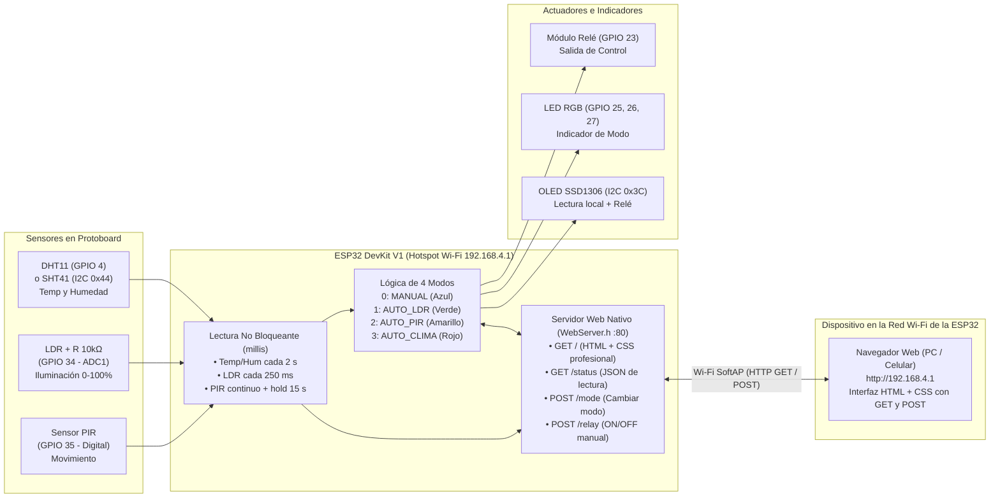
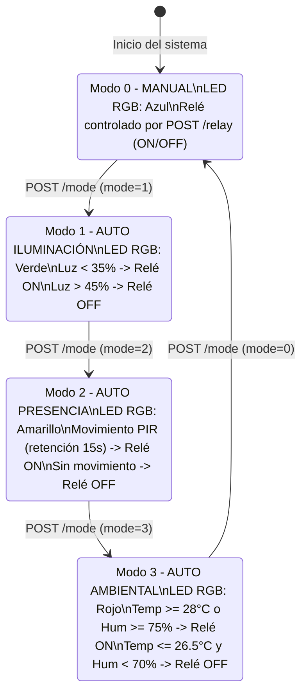

# Plan de Implementación — Práctica 2 (Unidad 2): Sistema Multisensor con Servidor Web ESP32

> [!IMPORTANT]
> **Contexto Académico y Proyecto Base**
> - **Institución:** Universidad Politécnica de Yucatán (UPY) — Ciclo Escolar 2026
> - **Docente:** M.I. Javier Poot
> - **Práctica:** Instructions for Practice 2 of Unit 2 — *"Sistema Multisensor con Servidor Web ESP32"* ([Instrucciones_UNIT_2_PRACTICE_2_IOT.pdf](file:///home/diorgos/Repositories/Multisensor_IoT_Device_ESP32/Instrucciones_UNIT_2_PRACTICE_2_IOT.pdf))
> - **Autores:** Diego López (GitHub: `DiegoLop3z` · `diegolopez.inquire@hotmail.com`) y Arturo Heredia (`arturoherediam.94@gmail.com`)
> - **Alcance:** En este repositorio implementaremos el **firmware completo**, el **servidor web embebido (HTML + CSS con GET y POST)**, el **Hotspot Wi-Fi en la ESP32**, y la **documentación y diagramas de hardware/arquitectura** (el reporte técnico queda a cargo de tu colaborador).

---

## 1. Análisis de las Instrucciones del PDF y Requerimientos

### 1.1 Objetivo de la Práctica
Desarrollar un **dispositivo IoT multisensor basado en ESP32**, capaz de adquirir información de diferentes sensores (**PIR, LDR y DHT11/SHT41**), procesarla mediante **diferentes modos de funcionamiento** (indicados físicamente por un **LED RGB**), controlar una salida (**módulo relé**) y alojar un **servidor web directamente en la ESP32** (funcionando como **Hotspot Wi-Fi**) para consultar y controlar el sistema desde cualquier navegador conectado a la red de la ESP32.

### 1.2 Materiales Requeridos y Equivalencias con el Proyecto Base

| # | Material Solicitado (PDF) | Implementación / Apoyo del Repo Base | Pin ESP32 Asignado |
|---|---|---|---|
| 1 | **1 ESP32** | ESP32 DevKit V1 (30 pines), validado con PlatformIO (`monitor_rts=0`, `monitor_dtr=0`) | — |
| 2 | **1 Sensor PIR** | Sensor piroeléctrico HC-SR501 / AM312 (detección digital de presencia) | `GPIO 35` (Entrada digital) |
| 3 | **1 LDR / Fotocelda** | Divisor de tensión (`3.3V → LDR → GPIO 34 → R 10kΩ → GND`) en canal **`ADC1`** | `GPIO 34` (`ADC1_CH6`) |
| 4 | **1 Sensor DHT11** | Sensor digital DHT11 (1-Wire) + soporte dual por `#define` para el **GY-SHT41** (I²C `0x44`) ya validado | `GPIO 4` (DHT11) / `GPIO 21, 22` (SHT41) |
| 5 | **1 LED RGB** | LED RGB de 4 terminales (cátodo común, o ánodo común configurable) con 3 resistores de 220 Ω | `GPIO 25` (R), `GPIO 26` (G), `GPIO 27` (B) |
| 6 | **1 Módulo Relé** | Módulo relevador de 1 canal (5V `VIN`, control lógico 3.3V) | `GPIO 23` (Salida digital) |
| 7 | **Pantalla OLED (Extra Base)** | OLED 128×32 SSD1306 (I²C `0x3C`) reutilizada de la Práctica 1 para visualización local | `GPIO 21` (SDA), `GPIO 22` (SCL) |
| 8 | **Pasivos y Montaje** | Protoboard 830 pts, 3× 220 Ω (RGB), 1× 10 kΩ (LDR), 1× 10 kΩ (pull-up DHT11), jumpers y cable USB de datos | Buses `3V3`, `VIN (5V)` y `GND` |

> [!WARNING]
> **Consideración Crítica de Hardware en ESP32 (`ADC1` vs `ADC2`):**
> En el ESP32, el bloque **`ADC2` no puede utilizarse mientras el periférico Wi-Fi está encendido**. Por ello, el divisor de tensión del **LDR se conecta en `GPIO 34` (`ADC1_CH6`)**, garantizando lecturas analógicas de 12 bits (`0–4095`) estables mientras el Hotspot Wi-Fi y el servidor web están activos.

### 1.3 Matriz de Trazabilidad de los 10 Requerimientos Funcionales

| # | Requerimiento Funcional (PDF) | Solución de Ingeniería Propuesta (Simple, Directa y Profesional) |
|---|---|---|
| **1** | Conectarse / Red Wi-Fi | **La ESP32 actúa como Hotspot Wi-Fi propio (`WiFi.softAP`)**: crea la red `ESP32-Multisensor` con IP fija `192.168.4.1` (y opción de modo mixto `WIFI_AP_STA` si se requiere). Así cualquier celular o laptop se conecta directo sin depender de routers ni configuraciones de red en Linux. |
| **2** | Implementar un servidor web en la ESP32 | Servidor HTTP ligero usando la librería estándar nativa `<WebServer.h>` en el puerto `80`, sin dependencias complejas ni brokers externos. Atiende peticiones **`GET` y `POST`** de forma no bloqueante en `loop()`. |
| **3** | Detectar movimiento mediante el sensor PIR | Lectura digital en `GPIO 35` con ventana de retención (*hold time* de 15 s con `millis()`) para mantener el estado activo de forma estable ante movimientos intermitentes. |
| **4** | Detectar el nivel de iluminación mediante el LDR | Lectura ADC en `GPIO 34` con media móvil simple (8 muestras), conversión a porcentaje (`0–100%`) y clasificación en 3 niveles (`OSCURO`, `MEDIO`, `ILUMINADO`). |
| **5** | Obtener temperatura y humedad mediante el DHT11 | Lectura cada `2000 ms` con validación `isnan()`. Incluye flag `#define USE_SHT41` por si prefieres usar en protoboard el sensor I²C GY-SHT41 de la práctica anterior. |
| **6** | Mostrar los valores de los sensores en la interfaz web | Interfaz **HTML + CSS** limpia y profesional (inspirada en los colores y tarjetas del dashboard anterior) que muestra Temperatura, Humedad, LDR y PIR claramente. |
| **7** | Controlar un módulo relé | Función `aplicarRele(bool encender)` en `GPIO 23` con soporte para lógica directa o invertida (`RELAY_ACTIVE_LOW`) y confirmación del estado real hacia la interfaz web y la OLED. |
| **8** | Controlar el sistema mediante diferentes modos | Máquina de estados clara con **4 modos de operación** (`MANUAL`, `AUTO_LDR`, `AUTO_PIR`, `AUTO_CLIMA`) seleccionables desde la página web mediante `POST /mode`. |
| **9** | Utilizar el LED RGB como indicador del modo | Función `actualizarLedRgb(ModoOperacion modo)` en `GPIO 25, 26, 27`: **Azul** (`MANUAL`), **Verde** (`AUTO_LDR`), **Amarillo** (`AUTO_PIR`) y **Rojo** (`AUTO_CLIMA`). |
| **10** | Visualizar el estado actual desde un navegador web | Al conectarse al Wi-Fi de la ESP32 y abrir `http://192.168.4.1/`, el navegador muestra en tiempo real los sensores, estado del relé, modo actual e indicador visual del LED RGB. |

---

## 2. Arquitectura del Sistema y Diseño de Lógica (Condición Importante)

Arquitectura simplificada, 100% autónoma en la ESP32 (sin Node-RED ni Mosquitto):



### 2.1 Diseño del Servidor Web HTML + CSS con `GET` y `POST`

Para mantener la infraestructura en la ESP32 **simple, fácil de explicar y profesional**:

1. **Librería estándar `<WebServer.h>` (incluida en el core de Arduino-ESP32):**
   - No requiere instalar librerías asíncronas externas ni sistemas de archivos SPIFFS/LittleFS.
   - El código HTML + CSS reside en un único archivo de cabecera (`src/web_dashboard.h`) dentro de un `raw literal` (`R"rawliteral(...)rawliteral"`) en memoria Flash (`PROGMEM`).
2. **Rutas HTTP claras (`GET` y `POST`):**
   - **`GET /`**: Entrega la página HTML + CSS con el diseño de tarjetas (inspirado en el dashboard de la práctica anterior: cabecera oscura `#2c3e50`, acentos naranja `#e66100`, tarjetas limpias con barras de nivel para Temperatura, Humedad y LDR, indicador de movimiento PIR, botones de selección de los 4 modos con el color del LED RGB y botón de encendido/apagado del relé).
   - **`GET /status`**: Devuelve un JSON compacto con el estado actual (`temp`, `hum`, `ldr_pct`, `ldr_state`, `pir`, `relay`, `mode`, `rgb`) que un script ligero de 25 líneas en la página consulta cada 2 segundos para mantener los números actualizados sin parpadeos.
   - **`POST /mode`**: Recibe el parámetro `mode` (`0`, `1`, `2` o `3`), cambia el modo en la ESP32, actualiza el color del **LED RGB**, ejecuta la lógica de decisión sobre el **Relé** y responde confirmando el nuevo estado real (soportando tanto envío por `fetch` como por formulario HTML clásico `<form method="POST" action="/mode">`).
   - **`POST /relay`**: Recibe `state=ON` o `state=OFF` (activo cuando el modo es `MANUAL`), conmuta el pin `GPIO 23` del **Módulo Relé** y devuelve la confirmación del estado físico real.

### 2.2 Lógica de los 4 Modos de Operación (Condición Importante)



---

## 3. Qué Reutilizamos del Repositorio Anterior (`esp32-monitoreo-ambiental-iot`)

1. **Entorno y configuración `platformio.ini`:**
   - `platform = espressif32`, `board = esp32dev`, `framework = arduino`, `monitor_speed = 115200`, `monitor_rts = 0` y `monitor_dtr = 0` (para que el monitor serie nunca bloquee la placa en reset).
   - Librerías para sensores y OLED (`Adafruit SHT4x Library`, `Adafruit SSD1306`, `Adafruit GFX Library`, `DHT sensor library`, `Adafruit Unified Sensor`), eliminando `PubSubClient` para no cargar código MQTT innecesario.
2. **Estructura de código no bloqueante (`millis()`):**
   - El patrón de lectura periódica sin `delay()`, la rutina de la pantalla OLED (`actualizarOled()`) adaptada para mostrar el modo y el estado del relé, el manejo de credenciales en `secrets.h` y el proyecto auxiliar `firmware/esp32-scanner-i2c`.
3. **Interacción con confirmación de estado real:**
   - El mismo principio validado en la práctica anterior (la interfaz web muestra el estado confirmado por el hardware de la ESP32 tras aplicar `digitalWrite` al relé y al LED RGB), pero implementado directamente con `POST` y `GET` en HTML/CSS sobre el servidor web de la ESP32.
4. **Scripts generadores de diagramas en Python (`docs/diagramas/`):**
   - Adaptaremos `diagrama_conexiones.py` y `diagrama_arquitectura.py` para generar los nuevos diagramas SVG y PNG del circuito multisensor y del servidor web en modo Hotspot.

---

## 4. Seteo del Repositorio, Git/GitHub (`DiegoLop3z`) y Limpieza del Repo Base

### 4.1 Estado Actual Ya Configurado en el Workspace

- **Repositorio Git inicializado en rama `main`** en `/home/diorgos/Repositories/Multisensor_IoT_Device_ESP32`.
- **Usuario y correo de GitHub configurados localmente:**
  - `user.name = DiegoLop3z`
  - `user.email = diegolopez.inquire@hotmail.com`
- **Archivos base listos:**
  - [`LICENSE`](file:///home/diorgos/Repositories/Multisensor_IoT_Device_ESP32/LICENSE) (MIT License — Diego López y Arturo Heredia).
  - [`.gitignore`](file:///home/diorgos/Repositories/Multisensor_IoT_Device_ESP32/.gitignore) (ignora `**/secrets.h`, `.pio/`, `.git-credentials` y el directorio `esp32-monitoreo-ambiental-iot/`).
  - [`README.md`](file:///home/diorgos/Repositories/Multisensor_IoT_Device_ESP32/README.md) (actualizado con tu usuario `@DiegoLop3z`, correo `diegolopez.inquire@hotmail.com`, arquitectura Hotspot en la ESP32 y servidor web HTML/CSS con `GET` y `POST`).

### 4.2 Comandos para Configurar el Token (PAT) de GitHub sin Afectar Bitbucket

Para no modificar tu configuración global de trabajo en Bitbucket (`diego.lopez@gasomarshal.mx`), tanto el usuario como el token de GitHub se configuran **exclusivamente a nivel local (`--local`)** o filtrados solo para el dominio `github.com`:

```bash
# 1. Confirmar usuario y correo de GitHub SOLO en este repositorio (--local)
git -C /home/diorgos/Repositories/Multisensor_IoT_Device_ESP32 config --local user.name "DiegoLop3z"
git -C /home/diorgos/Repositories/Multisensor_IoT_Device_ESP32 config --local user.email "diegolopez.inquire@hotmail.com"

# 2. Guardar el token de GitHub en un archivo exclusivo para GitHub (no toca Bitbucket)
printf "https://DiegoLop3z:%s@github.com\n" "<TU_TOKEN_GITHUB>" > ~/.git-credentials-github
chmod 600 ~/.git-credentials-github

# 3. Indicarle SOLO a este repositorio que use ese archivo de credenciales
git -C /home/diorgos/Repositories/Multisensor_IoT_Device_ESP32 config --local credential.helper "store --file=$HOME/.git-credentials-github"

# 4. Enlazar el repositorio remoto en GitHub y hacer push
git -C /home/diorgos/Repositories/Multisensor_IoT_Device_ESP32 remote add origin https://github.com/DiegoLop3z/Multisensor_IoT_Device_ESP32.git
git -C /home/diorgos/Repositories/Multisensor_IoT_Device_ESP32 add .
git -C /home/diorgos/Repositories/Multisensor_IoT_Device_ESP32 commit -m "Initial commit: configuracion del repo, README, LICENSE y plan de implementacion"
git -C /home/diorgos/Repositories/Multisensor_IoT_Device_ESP32 push -u origin main
```

### 4.3 Ignorado y Eliminación del Repositorio Base (`esp32-monitoreo-ambiental-iot`)

1. **Actualmente:** `esp32-monitoreo-ambiental-iot/` está en [`.gitignore`](file:///home/diorgos/Repositories/Multisensor_IoT_Device_ESP32/.gitignore#L13) para que no se suba ni ensucie el nuevo repositorio mientras reutilizamos sus scripts y configuración.
2. **Al terminar la implementación (Fase 4):** Ejecutaremos `rm -rf /home/diorgos/Repositories/Multisensor_IoT_Device_ESP32/esp32-monitoreo-ambiental-iot` para dejar el espacio de trabajo completamente limpio.

---

## 5. Fases de Ejecución

### Fase 1: Configuración del Repositorio Raíz (Completada)
- [x] Inicializar Git (`main`) y configurar `user.name = DiegoLop3z` y `user.email = diegolopez.inquire@hotmail.com`.
- [x] Crear [`LICENSE`](file:///home/diorgos/Repositories/Multisensor_IoT_Device_ESP32/LICENSE), [`.gitignore`](file:///home/diorgos/Repositories/Multisensor_IoT_Device_ESP32/.gitignore) y [`README.md`](file:///home/diorgos/Repositories/Multisensor_IoT_Device_ESP32/README.md).
- [x] Actualizar [`PLAN_IMPLEMENTACION.md`](file:///home/diorgos/Repositories/Multisensor_IoT_Device_ESP32/PLAN_IMPLEMENTACION.md) con la arquitectura Hotspot + Servidor Web HTML/CSS (`GET`/`POST`).

### Fase 2: Firmware Multisensor + Hotspot + Servidor Web HTML/CSS (`firmware/`) (Completada)
- [x] Crear [`firmware/esp32-multisensor-web/platformio.ini`](firmware/esp32-multisensor-web/platformio.ini) (con `monitor_rts = 0`, `monitor_dtr = 0` y librerías de sensores/OLED).
- [x] Crear [`firmware/esp32-multisensor-web/src/secrets.h.example`](firmware/esp32-multisensor-web/src/secrets.h.example) (con `AP_SSID`, `AP_PASSWORD` para el Hotspot de la ESP32 y opción de `WIFI_SSID` / `WIFI_PASSWORD`).
- [x] Desarrollar [`firmware/esp32-multisensor-web/src/web_dashboard.h`](firmware/esp32-multisensor-web/src/web_dashboard.h) con la interfaz **HTML + CSS** limpia y profesional, botones de modo y control de relé mediante peticiones `POST` y actualización de estado con `GET /status`.
- [x] Desarrollar [`firmware/esp32-multisensor-web/src/main.cpp`](firmware/esp32-multisensor-web/src/main.cpp) con lectura no bloqueante (`millis()`) de DHT11/SHT41, LDR (`GPIO 34`) y PIR (`GPIO 35`), máquina de 4 modos con histéresis, control de LED RGB (`GPIO 25, 26, 27`), Módulo Relé (`GPIO 23`), OLED (`0x3C`) y Servidor Web en puerto 80.
- [x] Incluir [`firmware/esp32-scanner-i2c`](firmware/esp32-scanner-i2c/src/main.cpp) como herramienta de diagnóstico rápido.

### Fase 3: Documentación de Hardware y Diagramas (`hardware/` y `docs/`) (Completada)
- [x] Crear [`hardware/hardware_conexion.md`](hardware/hardware_conexion.md) con lista de materiales, tabla de pines y cálculos eléctricos (divisor del LDR, resistencias de 220 Ω del LED RGB y control del relé).
- [x] Adaptar y ejecutar [`docs/diagramas/diagrama_conexiones.py`](docs/diagramas/diagrama_conexiones.py) → generar [`hardware/diagrama_conexiones.svg`](hardware/diagrama_conexiones.svg) y [`hardware/diagrama_conexiones.png`](hardware/diagrama_conexiones.png) (Entregable #2 del PDF).
- [x] Adaptar y ejecutar [`docs/diagramas/diagrama_arquitectura.py`](docs/diagramas/diagrama_arquitectura.py) → generar [`docs/diagrama_arquitectura.svg`](docs/diagrama_arquitectura.svg) y [`docs/diagrama_arquitectura.png`](docs/diagrama_arquitectura.png).
- [x] Redactar [`docs/documentacion_sistema_iot.md`](docs/documentacion_sistema_iot.md) con la explicación clara de los 6 puntos de la **Condición Importante**.

### Fase 4: Limpieza Final y Publicación en GitHub (Completada)
- [x] Eliminar el repositorio de referencia `esp32-monitoreo-ambiental-iot/`.
- [x] Crear repositorio público en GitHub (`DiegoLop3z/Multisensor_IoT_Device_ESP32`), realizar commit inicial y `git push -u origin main`.
