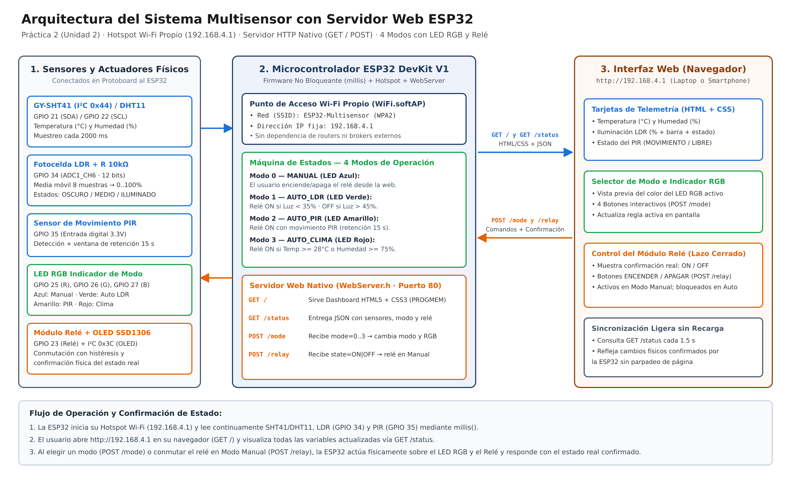

# Documentación Técnica del Sistema Multisensor con Servidor Web ESP32

Esta guía documenta la arquitectura, la lógica de decisión y el funcionamiento interno del sistema para responder de forma directa a todos los puntos solicitados en la **Condición Importante** de las instrucciones de la **Práctica 2 (Unidad 2)**.



---

## 1. ¿Cómo obtiene información cada sensor?

1. **Sensor de Temperatura y Humedad (GY-SHT41 en I²C `0x44` / DHT11 en `GPIO 4`):**
   - **GY-SHT41:** Se comunica mediante el bus serie síncrono **I²C** (`GPIO 21` SDA y `GPIO 22` SCL) en la dirección `0x44`. Cada `2000 ms`, la ESP32 solicita una medición de alta precisión y recibe una trama digital de 16 bits para temperatura y 16 bits para humedad relativa con verificación CRC.
   - **DHT11 (respaldo automático):** Si al iniciar no se detecta el SHT41 en I²C, el firmware lee automáticamente el pin `GPIO 4` mediante protocolo *1-Wire*, decodificando los 40 bits (humedad entera/decimal, temperatura entera/decimal y byte de *checksum*).
2. **Sensor de Iluminación — Fotocelda LDR (`GPIO 34`, `ADC1_CH6`):**
   - La fotorresistencia (LDR) disminuye su resistencia óhmica cuando incide luz sobre su superficie de sulfuro de cadmio (CdS) y la incrementa en la oscuridad.
   - Conectada en serie con un resistor fijo de $10\,\text{k}\Omega$ entre $3.3\,\text{V}$ y $\text{GND}$, forma un **divisor de tensión** cuyo nodo central entrega un voltaje analógico continuo ($0$ a $3.3\,\text{V}$) al pin `GPIO 34` cada `250 ms`.
3. **Sensor de Movimiento — PIR (`GPIO 35`):**
   - El sensor piroeléctrico pasivo (PIR) mide cambios en la radiación infrarroja emitida por personas u objetos cálidos en movimiento a través de su lente Fresnel.
   - Entrega una señal digital binaria en `GPIO 35`: nivel alto (`HIGH`, $3.3\,\text{V}$) cuando detecta movimiento y nivel bajo (`LOW`, $0\,\text{V}$) en reposo.

---

## 2. ¿Cómo procesa la ESP32 dicha información?

Todo el procesamiento ocurre dentro del ciclo `loop()` mediante temporizadores no bloqueantes basados en `millis()` (sin usar `delay()`), para que el servidor web responda de inmediato en todo momento:

- **Filtrado del LDR (Media Móvil de 8 muestras):**
  El convertidor analógico-digital (ADC de 12 bits, rango `0` a `4095`) del ESP32 puede presentar pequeñas fluctuaciones eléctricas. El firmware almacena las últimas 8 lecturas en un arreglo circular (`bufferLdr`), calcula su promedio aritmético (`ldrCrudo`) y lo transforma a escala porcentual (`0–100%`):
  $$\text{ldrPorcentaje} = \text{constrain}\left(\text{round}\left(\frac{\text{ldrCrudo}}{4095.0} \times 100\right),\, 0,\, 100\right)$$
  A partir de este porcentaje, clasifica el estado lumínico en tres categorías:
  - `OSCURO`: $< 35\%$
  - `MEDIO`: $35\%$ a $70\%$
  - `ILUMINADO`: $> 70\%$
- **Ventana de Retención del PIR (*Hold Time* de 15 s):**
  Los sensores PIR suelen bajar su señal a `LOW` durante breves instantes si una persona permanece quieta. Cuando `GPIO 35` pasa a `HIGH`, la ESP32 activa `movimientoActivo = true` y guarda el instante `ultimoMovimientoMs = millis()`. El estado `movimientoActivo` se mantiene verdadero hasta que transcurren `15000 ms` continuos sin nuevos pulsos del PIR.
- **Validación de Temperatura y Humedad:**
  Se comprueba que las lecturas no sean `NaN` (`!isnan(t)`) antes de actualizar `temperaturaActual` y `humedadActual`.

---

## 3. ¿Cómo se toman las decisiones y cómo se utilizan los modos de operación?

El sistema implementa una **máquina de estados finitos (`evaluarLogicaControl()`)** con **4 modos de operación** y **ciclos de histéresis** (diferencia entre el umbral de encendido y el de apagado) para evitar que el relé conmute erráticamente cuando una variable oscila cerca del límite:

| ID | Modo | Color LED RGB (`GPIO 25, 26, 27`) | Regla de Decisión sobre el Módulo Relé (`GPIO 23`) |
|---|---|---|---|
| `0` | **`MANUAL`** | 🔵 **Azul** `(R=0, G=0, B=1)` | **Control directo del usuario:** La ESP32 desactiva el disparo automático por sensores y obedece únicamente las órdenes `ON` / `OFF` enviadas desde los botones de la página web (`POST /relay`). |
| `1` | **`AUTO_LDR`** | 🟢 **Verde** `(R=0, G=1, B=0)` | **Control por iluminación con histéresis:** Si la luz cae a `< 35%` (`OSCURO`), **enciende** el relé. Solo lo **apaga** cuando la iluminación supera `> 45%`. Entre `35%` y `45%` conserva su estado previo. |
| `2` | **`AUTO_PIR`** | 🟡 **Amarillo** `(R=1, G=1, B=0)` | **Control por presencia:** Si `movimientoActivo == true` (hay movimiento o sigue dentro de los 15 s de retención), **enciende** el relé; al expirar el tiempo sin presencia, lo **apaga**. |
| `3` | **`AUTO_CLIMA`** | 🔴 **Rojo** `(R=1, G=0, B=0)` | **Control ambiental con histéresis:** Si `Temperatura >= 28.0 °C` **o** `Humedad >= 75.0%`, **enciende** el relé (ventilación). Solo lo **apaga** cuando la temperatura baja a `<= 26.5 °C` **y** la humedad baja a `< 70.0%`. |

---

## 4. ¿Cómo se controla el módulo relé?

- La función `aplicarRele(bool encender)` controla el pin `GPIO 23` (y refleja el mismo estado en el LED azul integrado `GPIO 2` del ESP32 para verificación rápida).
- Soporta módulos relé tanto de lógica directa (activos en `HIGH`) como optoacoplados activos en bajo (`RELAY_ACTIVE_LOW`).
- Solo ejecuta el cambio físico y el refresco de la pantalla OLED cuando el nuevo estado difiere del estado actual (`releEncendido != encender`), y reporta dicho estado confirmado en la respuesta JSON hacia la interfaz web.

---

## 5. ¿Cómo funciona el servidor web en la ESP32?

1. **Red Propia (Hotspot SoftAP):**
   Al arrancar en `setup()`, la ESP32 ejecuta `WiFi.softAP(AP_SSID, AP_PASSWORD)`, creando la red Wi-Fi **`ESP32-Multisensor`** con dirección IP fija **`192.168.4.1`**. Cualquier computadora o teléfono se conecta a esta red sin necesitar internet ni un router externo.
2. **Servidor HTTP Ligero (`WebServer server(80)`):**
   Escucha en el puerto TCP `80` y registra 4 endpoints basados en verbos estándar `GET` y `POST`:
   - **`GET /` (`handleRootGet`)**: Envía desde la memoria Flash (`PROGMEM`) la página `INDEX_HTML` definida en `src/web_dashboard.h` (HTML5 + CSS3 responsivo).
   - **`GET /status` (`handleStatusGet`)**: Construye y devuelve en tiempo real un objeto JSON con las lecturas de todos los sensores, el estado del relé, el modo actual y el color hexadecimal del LED RGB:
     ```json
     {
       "temp": 25.4,
       "hum": 58.2,
       "sensor": "SHT41 (I2C)",
       "ldr_raw": 1840,
       "ldr_pct": 45,
       "ldr_state": "MEDIO",
       "pir": false,
       "relay": false,
       "mode": 0,
       "mode_name": "MANUAL",
       "rgb": "#0066ff",
       "uptime": 128
     }
     ```
   - **`POST /mode` (`handleModePost`)**: Recibe `mode=0..3` (`application/x-www-form-urlencoded`), llama a `seleccionarModo()`, actualiza el LED RGB, evalúa el relé y devuelve el JSON de estado confirmado.
   - **`POST /relay` (`handleRelayPost`)**: Verifica que el sistema esté en `MODO_MANUAL` (si está en modo automático devuelve código HTTP `409 Conflict`), recibe `state=ON` o `state=OFF`, conmuta `GPIO 23` y devuelve el JSON confirmado.

