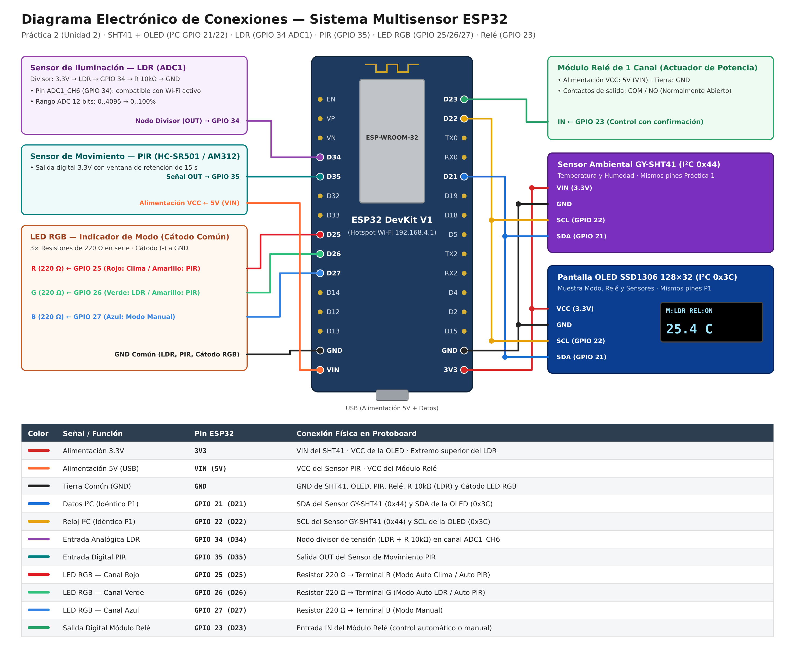

# Hardware — Lista de Materiales, Pines y Diagrama Electrónico

## 1. Lista de Materiales (BOM)

| # | Componente | Especificación | Cantidad | Estado en Protoboard |
|---|---|---|---|---|
| 1 | Microcontrolador | ESP32 DevKit V1, 30 pines (Wi-Fi + ADC1 + I²C) | 1 | Base (ya montado) |
| 2 | Sensor Temp/Humedad | GY-SHT41 (I²C `0x44`) / DHT11 (Digital 1-Wire) | 1 | Base (SHT41 ya montado en `GPIO 21/22`) |
| 3 | Pantalla Local | OLED 128×32 SSD1306 (I²C `0x3C`) | 1 | Base (ya montada en `GPIO 21/22`) |
| 4 | Sensor de Movimiento | PIR HC-SR501 o AM312 (Salida digital 3.3V) | 1 | Nuevo (`GPIO 35`) |
| 5 | Sensor de Iluminación | Fotocelda LDR + Resistor de 10 kΩ (1/4 W) | 1 + 1 | Nuevo (`GPIO 34` — `ADC1_CH6`) |
| 6 | Indicador de Modo | LED RGB de 5 mm (4 pines) + 3× Resistores de 220 Ω | 1 + 3 | Nuevo (`GPIO 25, 26, 27`) |
| 7 | Actuador de Potencia | Módulo Relé de 1 canal (alimentación 5V, lógica 3.3V) | 1 | Nuevo (`GPIO 23`) |
| 8 | Montaje y Alimentación | Protoboard de 830 puntos, jumpers M-M / M-H y cable USB de datos | 1 lote | Base |

---

## 2. Diagrama Electrónico de Conexiones

Versión vectorial editable: [`diagrama_conexiones.svg`](diagrama_conexiones.svg).

---

## 3. Asignación Completa de Pines en la ESP32

### 3.1 Bus I²C Compartido (Idéntico a la Práctica Anterior — No mover cables)

El sensor **GY-SHT41** y la pantalla **OLED SSD1306** conservan exactamente las mismas conexiones validadas en la práctica anterior:

| Señal | Pin ESP32 | Destino Físico |
|---|---|---|
| Alimentación 3.3V | `3V3` | `VIN` del SHT41 y `VCC` de la OLED |
| Tierra común | `GND` | `GND` del SHT41 y `GND` de la OLED |
| Datos I²C (SDA) | **`GPIO 21` (D21)** | `SDA` del SHT41 (`0x44`) y `SDA` de la OLED (`0x3C`) |
| Reloj I²C (SCL) | **`GPIO 22` (D22)** | `SCL` del SHT41 (`0x44`) y `SCL` de la OLED (`0x3C`) |

*(Nota: Si en algún momento se desea conectar un DHT11 en lugar del SHT41, su pin `DATA` va a `GPIO 4` con pull-up de 10 kΩ a `3V3`).*

### 3.2 Nuevos Sensores (LDR y PIR)

| Componente | Señal | Pin ESP32 | Conexión Física |
|---|---|---|---|
| **Fotocelda LDR** | Entrada Analógica (`ADC1_CH6`) | **`GPIO 34` (D34)** | `3V3` → **LDR** → nodo `GPIO 34` → **Resistor 10 kΩ** → `GND` |
| **Sensor PIR** | Entrada Digital | **`GPIO 35` (D35)** | `VCC` a `VIN` (5V), `GND` a `GND`, salida `OUT` a `GPIO 35` |

> **¿Por qué `GPIO 34` (`ADC1`) para el LDR?**  
> En el ESP32, los canales del bloque `ADC2` quedan bloqueados por hardware mientras el Wi-Fi está activo. Al usar `GPIO 34` (que pertenece a `ADC1`), la lectura analógica de 12 bits (`0–4095`) funciona simultáneamente con el Hotspot Wi-Fi y el servidor web sin interferencias.

### 3.3 Nuevos Actuadores (Módulo Relé y LED RGB)

| Componente | Señal | Pin ESP32 | Conexión Física |
|---|---|---|---|
| **Módulo Relé** | Salida Digital de Control | **`GPIO 23` (D23)** | `VCC` a `VIN` (5V), `GND` a `GND`, entrada `IN` a `GPIO 23` |
| **LED RGB (Rojo)** | Canal R (Modo Auto Clima / PIR) | **`GPIO 25` (D25)** | `GPIO 25` → **Resistor 220 Ω** → pin `R` del LED RGB |
| **LED RGB (Verde)** | Canal G (Modo Auto LDR / PIR) | **`GPIO 26` (D26)** | `GPIO 26` → **Resistor 220 Ω** → pin `G` del LED RGB |
| **LED RGB (Azul)** | Canal B (Modo Manual) | **`GPIO 27` (D27)** | `GPIO 27` → **Resistor 220 Ω** → pin `B` del LED RGB |
| **LED RGB (Común)** | Cátodo Común (`-`) | **`GND`** | Pata más larga del LED RGB a `GND` (o a `3V3` si es ánodo común, cambiando `RGB_COMMON_ANODE = true` en `main.cpp`) |

---

## 4. Cálculos Eléctricos de Diseño

1. **Divisor de Tensión del LDR (`GPIO 34`):**
   $$V_{\text{ADC}} = 3.3\,\text{V} \cdot \frac{R_{\text{fija}}}{R_{\text{LDR}} + R_{\text{fija}}}, \quad R_{\text{fija}} = 10\,\text{k}\Omega$$
   - Con **alta iluminación** ($R_{\text{LDR}} \approx 1\text{–}2\,\text{k}\Omega$), $V_{\text{ADC}} \approx 2.8\text{–}3.0\,\text{V}$ ($\text{ADC} \approx 3500\text{–}3800$, $> 80\%$).
   - En **oscuridad** ($R_{\text{LDR}} > 50\,\text{k}\Omega$), $V_{\text{ADC}} < 0.55\,\text{V}$ ($\text{ADC} < 700$, $< 20\%$).

2. **Limitación de Corriente del LED RGB (`GPIO 25, 26, 27`):**
   - Canal Rojo ($V_F \approx 2.0\,\text{V}$): $I_R = \frac{3.3\,\text{V} - 2.0\,\text{V}}{220\,\Omega} \approx 5.9\,\text{mA}$.
   - Canales Verde y Azul ($V_F \approx 3.0\,\text{V}$): $I_{G,B} = \frac{3.3\,\text{V} - 3.0\,\text{V}}{220\,\Omega} \approx 1.4\,\text{mA}$.
   - En todos los casos la corriente por pin es muy inferior al máximo permitido por el ESP32 ($12\,\text{mA}$ recomendados por GPIO).

---

## 5. Diagnóstico Rápido en Protoboard

1. **Verificar Bus I²C (`0x3C` y `0x44`):** Si al arrancar aparece en el monitor serie `[OK] Pantalla OLED SSD1306 detectada en 0x3C` y `[OK] Sensor GY-SHT41 detectado en I2C 0x44`, el bus I²C está listo. También puedes usar `firmware/esp32-scanner-i2c`.
2. **Invertir lógica del Relé o LDR sin recablear:**
   - Si tu módulo relé enciende cuando el pin está en `LOW`, cambia `RELAY_ACTIVE_LOW = true` en `src/main.cpp`.
   - Si conectaste el LDR hacia `GND` y la resistencia de 10 kΩ hacia `3V3`, cambia `LDR_INVERTED = true` en `src/main.cpp`.

